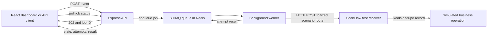

# HookFlow

HookFlow is a small webhook delivery engine and dashboard. It accepts an event, places a delivery job on a Redis-backed BullMQ queue, and lets a separate worker make the HTTP request. The React dashboard shows the job's BullMQ state and its real delivery-attempt history.

This is a learning and portfolio project. Its HTTP deliveries currently go only to HookFlow's controlled test receivers. The API does **not** let a caller choose an arbitrary destination URL.

## What is implemented

- Express API and a React, TypeScript, and Vite dashboard.
- Redis-backed BullMQ demo and webhook-delivery queues.
- Four controlled receiver scenarios: `success`, `transient`, `failure`, and `permanent`.
- Real HTTP POST requests from the worker using Node's `fetch`, with a five-second timeout.
- Up to three delivery attempts with exponential backoff, starting at two seconds.
- Per-attempt HTTP/error details and BullMQ job status in the API and dashboard.
- Optional producer-side idempotency keys, recorded atomically in Redis for 24 hours.
- Redis-backed deduplication in the simulated receiver, retained for 30 days.
- Local Redis through Docker Compose, with Redis published only to `127.0.0.1:6380` on the development machine.
- Rate limits and queue-capacity checks for the anonymous demo, plus bounded BullMQ job retention.
- A combined API-and-worker start command for the prepared free-tier deployment, as well as separate production commands for hosting the API and worker independently.

## Illustrative webhook use cases

These examples show the kinds of events a webhook system can carry. They are **not integrations built into HookFlow**. The current demo does not connect to commerce platforms, payment providers, inventory systems, or customer SaaS applications; it sends to its controlled test receiver.

| Example | Illustrative event | How a receiving application might use it |
| --- | --- | --- |
| E-commerce order processing | `order.created` | A store could ask a fulfillment service to prepare an order after validating its order ID and line items. |
| Payment confirmation | `payment.succeeded` | An application could confirm an order after verifying the event with its payment provider. HookFlow does not verify provider signatures or process payments. |
| Inventory synchronization | `inventory.adjusted` | A receiving inventory service could update the available quantity for a SKU and location. |
| SaaS event notifications | `subscription.updated` | A SaaS application could update an account's entitlements when its subscription plan or status changes. |

In the dashboard or API, the `eventType` and `payload` fields can describe examples like these. The required `scenario` field selects one of HookFlow's test responses; it does not identify an integration or destination.

## Delivery flow



The API is the **producer**: it validates an event and adds a job to BullMQ, then returns `202 Accepted` with a job ID. Redis stores the queue and idempotency records. A **worker** reads queued jobs and performs delivery outside the request-response path. The dashboard polls the status endpoint by job ID; accepting a job does not mean the webhook has already been delivered.

## Retry and idempotency behavior

The worker treats any `2xx` response as a successful delivery. HTTP `5xx`, `408`, `429`, network errors, and timeouts are retryable. Other `4xx` responses are permanent and stop without another attempt. BullMQ allows at most three total attempts, with exponential backoff of two seconds and then four seconds. Failed jobs are retained for inspection, subject to the configured retention limits.

Retries mean the same event can reach a receiver more than once. If the sender times out after a receiver has performed its work, the sender cannot know whether that work happened; it may retry. The demo sends a stable event ID and uses an atomic Redis record in its simulated receiver so repeat attempts do not repeat that simulated operation. This demonstrates **at-least-once delivery with receiver-side deduplication**, not exactly-once delivery for real business transactions.

For producer-side deduplication, clients can send an optional `Idempotency-Key` header. The key must be 1–128 letters, digits, dots, underscores, tildes, or hyphens. HookFlow stores a request fingerprint and job ID atomically in Redis:

- The same key and same event return the original job ID.
- Reusing the key with a different event type, payload, or scenario returns `409 Conflict`.
- The record lasts 24 hours. Once it expires, a later request may create a new job.
- Receiver dedupe records last 30 days in the demo. These retention periods are examples, not universal guarantees.

Both idempotency mechanisms depend on Redis state. In the free deployment that state may be lost if the free Redis-compatible service restarts.

## API

| Method and path | Purpose | Typical responses |
| --- | --- | --- |
| `GET /health` | Liveness check | `200` with `{"status":"ok","service":"hookflow"}` |
| `GET /ready` | Checks API readiness and Redis | `200` when ready, `503` when Redis is unavailable or shutdown is underway |
| `POST /api/demo-jobs` | Enqueues the original demo message job | `202`, `400`, or `503` |
| `GET /api/demo-jobs/:id` | Reads a demo job's state and result | `200` or `404` |
| `POST /api/webhook-events` | Validates and enqueues a webhook event | `202` with a job ID, `400` invalid input, `409` idempotency conflict, `429` rate limited, or `503` unavailable/at capacity |
| `GET /api/webhook-events/:id` | Reads BullMQ state, attempts, retry status, result, and failure reason | `200` or `404` |

Webhook event JSON has this shape:

```json
{
  "eventType": "order.created",
  "payload": {
    "orderId": "order_demo_42",
    "itemCount": 2
  },
  "scenario": "success"
}
```

`eventType` is required and limited to 100 characters. `payload` must be a JSON object no larger than 8 KB. The overall JSON request body is limited to 16 KB. `scenario` must be one of the four controlled values:

| Scenario | Test receiver response | Expected job outcome |
| --- | --- | --- |
| `success` | Always HTTP 200 | Completes after one attempt |
| `transient` | HTTP 500 twice, then HTTP 200 | Completes on attempt three |
| `failure` | Always HTTP 500 | Fails after three total attempts |
| `permanent` | HTTP 400 | Fails after one attempt without retries |

The transient receiver uses the attempt number supplied with each delivery, so its behavior is isolated per job rather than tracked by a shared counter.

## Run locally

Use Node.js 22 or newer and Docker Compose. From the repository root, start the local Redis service:

```sh
docker compose up -d redis
```

In one terminal, install and start the API:

```sh
cd backend
npm ci
npm run dev
```

In a second terminal, start the worker:

```sh
cd backend
npm run dev:worker
```

In a third terminal, start the dashboard:

```sh
cd frontend
npm ci
npm run dev
```

The Vite development server proxies `/api` and `/health` to `http://127.0.0.1:3000`. The backend reads `REDIS_URL` when provided; otherwise it uses `127.0.0.1:6380`, matching `compose.yaml`. See [`backend/.env.example`](backend/.env.example) and [`frontend/.env.example`](frontend/.env.example) for variable names. The backend does not automatically load `.env` files; export overrides in the shell or set them in the hosting service.

### Submit and inspect a job

With Redis, the API, and worker running, submit a test delivery:

```sh
curl -i -X POST http://127.0.0.1:3000/api/webhook-events \
  -H 'Content-Type: application/json' \
  -H 'Idempotency-Key: readme-order-001' \
  --data '{"eventType":"order.created","payload":{"orderId":"order_demo_42","itemCount":2},"scenario":"success"}'
```

The response is `202` with a `jobId`. Use that ID to check the actual BullMQ state and delivery history:

```sh
curl -i http://127.0.0.1:3000/api/webhook-events/JOB_ID
```

Try a retry that recovers by changing `scenario` to `transient` and using a different idempotency key. Try exhaustion with `failure` or the one-attempt permanent failure with `permanent`. In the dashboard, choose the scenario and optionally use the same key twice to see duplicate behavior.

### Build and test

```sh
cd backend
npm run typecheck
npm test
npm run build
```

```sh
cd frontend
npm run build
```

To run the compiled API and worker together locally, build the backend first, then run:

```sh
cd backend
NODE_ENV=development PORT=3000 npm run start:combined
```

Press `Ctrl-C` to ask the supervisor to stop both processes. For separate production services, use `npm run start:api` and `npm run start:worker` instead.

## Deployment preparation and limitations

The repository includes a GitHub Pages workflow and a Render Free combined-service setup, but HookFlow is **not deployed by this repository change**. GitHub Pages builds the frontend under `/HookFlow/` and needs a repository Actions variable named `VITE_API_BASE_URL` set to the public Render API URL ending in `/api`. The Render API must set `CORS_ALLOWED_ORIGINS` to the exact Pages origin, such as `https://OWNER.github.io`; CORS origins do not include the `/HookFlow/` path.

Render Free services can sleep when idle, so the combined worker is not always on and jobs may wait until the service wakes. Free Key Value can restart and lose queue and idempotency data. The demo's rate limits, pending-job caps, and retention reduce resource use but are not a durability guarantee. Read [`docs/FREE_DEPLOYMENT.md`](docs/FREE_DEPLOYMENT.md) before setting up the free deployment and [`docs/DEPLOYMENT.md`](docs/DEPLOYMENT.md) for the separate-service production-readiness notes.

HookFlow currently has no customer-configured webhook destinations, webhook signature verification, multi-tenant credentials, persistent business database, or real payment/inventory/order integrations. The test receiver only simulates an operation in Redis. Do not use the demo scenarios to perform real payments, send customer notifications, or update production inventory.

## Repository layout

```text
backend/       Express API, Redis/BullMQ queues, worker, and tests
frontend/      React/Vite dashboard
docs/          Idempotency and deployment notes
.github/       GitHub Pages build-and-publish workflow
compose.yaml   Local Redis development service
```
